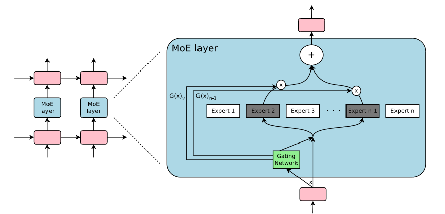
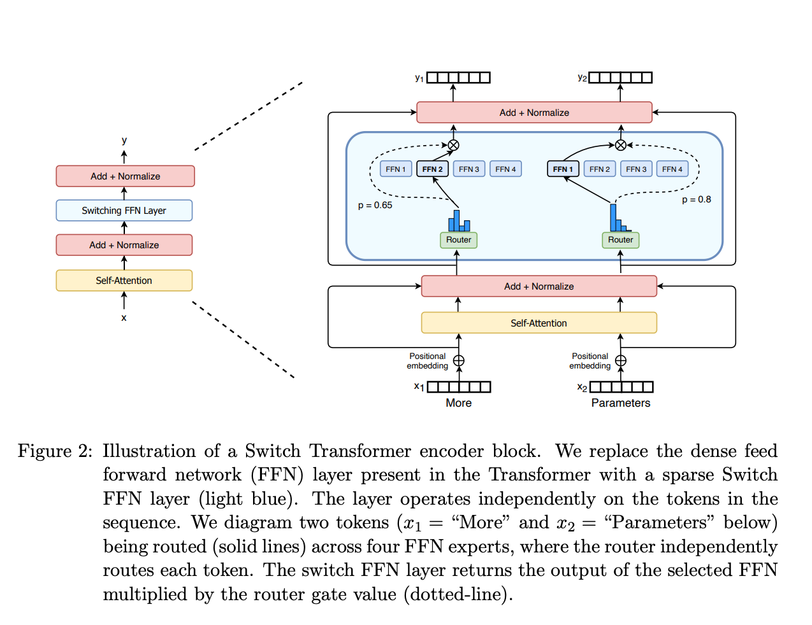
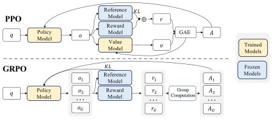
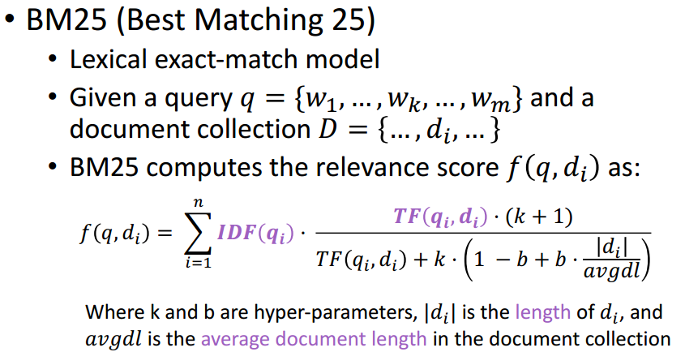

# 通用点:

- 自我介绍：
  面试官，您好。我是xxx，21年毕业于xxxx，目前已经快四年的工作经验。
  第一份工作是在xxx，主要从事采用一些机器学习的算法来实现新能源风电功率的预测以及
  功率准确性的提升；第二份工作在xxx，
  主要从事构建基于LL的智能运维的Agent系统以及AI机器平台开发的工作,在xxxx期间也获得了优秀新员工，
  优秀毕业生的荣誉。
  有三年的python开发基础，对java和前端也有一定的理解。在llm方面，熟悉function calling，对rag和llm微调，
  部署等有一定的了解
- 项目简介：
  我们设计了一套智能运维系统，用户可以通过简单的自然语言交互的能力,获得智能报表，智能分析与诊断，闲聊的功能。
  架构设计上来说，自上而下分为场景Agent->专家Agent->能力Angent。而我们这边主要专注做的是实现能力Agent,
  并将其赋予专家Agent中。
  目前，我们包含了以下几类智能体。查询诊断类（function calling），电信问答（也就是rag），
  文本转SQL，闲聊的功能。我们支持向
  原始的chatgpt直接问答，也可以agent的交互的方式
  从组件交互上来说，我们自上而下是chatbot前端，chatbot后端，aiOps(我们这边实现的)，业务方。
  我主要参与的是查询诊断，也就是functioning calling的功能的设计，这边我们主要是维护一个DSL文件。
  这个LPI文件包含LPI的描述，语义参数，大模型的描述呀，请求体参数，输入，输出，正常和异常返回值呀，权限管理呀.
  关键技术，这边主要两大技术多轮对话下模型微调提升意图理解准确性和槽位提取准确性以及多函数连续调用，
  分支调用功能
- 如何微调：

  1. 函数查找的微调以及函数参数的微调
  2. 基础语料的准备，数据增强动作。基于prompt做数据增强动作
  3. 人工的校验
  4. 数据的预处理，格式化处理，组装成多轮对话
  5. LoRa的微调
  6. 模型的评估的工具
  7. 反复迭代
- 准确性如何达到98%
  包含（上述微调工作）
  只取三轮
  函数查找那边是三轮对话
  参数解析那边只有上一轮对话
  对于一些参数处理后处理校验呀
  参数解析处调用两次大模型

  

# 面试

# 字节财经

合并两个有序数组

无状态状态机什么意思？

为什么要从传统语义树转为大模型？

IdentityBot->ColllectionBot ？

route->intent->generation？

用户增量合并什么意思？

注入prompt的内容包括哪些？策略的来源部分？

多任务sft？


## 懂车帝

moe和dense的区别？

> 参考：[LLM 基础：模型架构 Dense &amp; MoE - Kai-nothinking的文章 - 知乎](https://zhuanlan.zhihu.com/p/1991216496177874322)

**Dense（稠密）模型**：所有参数对所有 token 都参与计算，每个 FFN 层是单一网络，如 LLaMA、GPT-3。

**MoE（Mixture of Experts，混合专家）模型**：基于 Transformer 架构，将传统 Transformer 中的 FFN 层替换为 MoE 层，主要由两部分组成：

1. **稀疏 MoE 层**：包含若干"专家"（例如 8 个），每个专家本身是一个独立的神经网络（通常是 FFN）。
2. **门控网络（路由）**：决定哪些 token 被发送到哪个专家，路由器由学习的参数组成，与网络其他部分一同预训练。

$$
y = \sum_{i=1}^{n} G(x)_i E_i(x)
$$

门控函数通常是带 softmax 的简单网络：

$$
G_\sigma(x) = \text{Softmax}(x \cdot W_g)
$$

实际使用 **Noisy Top-K Gating**：

1. 添加噪声：$H(x)_i = (x \cdot W_g)_i + \text{StandardNormal()} \cdot \text{Softplus}((x \cdot W_{noise})_i)$
2. 选择保留前 k 个值（其余设为 $-\infty$）：$\text{KeepTopK}(v, k)_i = \begin{cases} v_i & \text{if } v_i \text{ is in the top } k \\ -\infty & \text{otherwise} \end{cases}$
3. 应用 Softmax：$G(x) = \text{Softmax}(\text{KeepTopK}(H(x), k))$

**MoE 的优势**（与 Dense 相比）：

- 预训练速度更快、效果更好：相同计算预算下能更快达到相同质量水平（Switch Transformer 相同资源下达到指定 PPL 比 T5-XXL 快 4 倍）
- 相同参数下推理成本低：每个 token 只激活部分专家
- 扩展性好：允许在保持计算成本不变的情况下增加参数数量，可扩展到万亿参数规模
- 多任务学习能力强：Switch Transformer 在所有 101 种语言上都显示出性能提升

**MoE 的缺点**：

- 训练稳定性：训练过程中可能遇到稳定性问题（可用混合精度训练、更小的参数初始化、Router z-loss 缓解）
- 通信成本：分布式训练中专家路由机制增加通信成本
- 模型复杂性：设计和优化需要更多工程努力
- 微调易过拟合：稀疏性导致 Fine-tuning 过程中容易出现过拟合（可用更大的 dropout、更高学习率、更小 batch size 缓解）

**关键概念：专家容量（Expert Capacity）**

$$
\text{Expert Capacity} = \left(\frac{\text{tokens per batch}}{\text{number of experts}}\right) \times \text{capacity factor}
$$

- 容量因子 > 1 时为超量分配的 token 提供缓冲空间；溢出的 token 跳过计算，直接通过残差连接传递到下一层
- Switch Transformer 在低容量因子（1 至 1.25）下表现出色

**负载均衡辅助损失**（Switch Transformer）：

$$
loss = \alpha \cdot N \cdot \sum_{i=1}^{N} f_i \cdot P_i
$$

其中 $f_i$ 是分配给专家 $i$ 的 token 占比，$P_i$ 是所有 token 路由到专家 $i$ 的平均概率，$N$ 是专家数量，$\alpha$ 是权重系数（论文取 0.01）。均匀路由时该损失最小，防止门控网络总是激活相同的几个专家。

**Router z-loss**（ST-MoE 提出，用于稳定训练）：

$$
L_z = \frac{1}{B}\sum_{i=1}^{B}\left(\log\sum_{j=1}^{N}e^{x_{ij}}\right)^2
$$

惩罚较大的 logits 值，减少计算中的舍入误差，提升训练稳定性。





**典型 MoE 模型对比**：

| 模型           | 类型                | 参数量                          | 激活参数量      |
| -------------- | ------------------- | ------------------------------- | --------------- |
| GPT-3          | Dense Decoder-only  | 175B                            | 175B            |
| GShard-M4      | MoE Encoder-decoder | 600B                            | 1.5B            |
| Switch-C       | MoE Encoder-decoder | 1.5T                            | 1.5B            |
| GLaM (64B/64E) | MoE Decoder-only    | 1.2T                            | 96.6B           |
| Mixtral 8x7B   | MoE Decoder-only    | 47B（8 个 FFN 专家 + 共享参数） | 约 13B（Top-2） |

注意：Mixtral 8x7B 需要能容纳 47B 参数的显存（只有 FFN 层是独立专家，注意力等参数共享），但推理 FLOPs 类似 12B 模型（Top-2 门控实际使用约 14B 参数，注意力等共享部分使其降为 12B）。

**如何选择**：稀疏 MoE 适合拥有多台机器、要求高吞吐量的场景；显存较少、吞吐量要求不高时选 Dense。两类模型不能直接比较参数数量。

grpo了解吗？

GRPO（Group Relative Policy Optimization，组相对策略优化）是 DeepSeek 在 DeepSeekMath 中提出的强化学习算法，是 PPO 的变体，也是 DeepSeek-R1 使用的核心 RL 算法。

> 参考：[DeepSeekMath 论文](https://arxiv.org/abs/2402.03300)、[看完能和外婆解释的PPO, DPO, GRPO强化学习 - Ryann的文章 - 知乎](https://zhuanlan.zhihu.com/p/1984387073625593089)

**PPO 的四个组件**：

1. Actor（需更新参数）

- 角色：主角。这就是我们正在训练、希望它变符合我们预期的那个模型。
- 任务：负责根据问题生成回答。

2. Reference Model 参考模型（冻结参数）

- 角色：SFT 后的原始模型副本。
- 任务：它不参与打分，而是作为约束。它时刻提醒 Actor："你别为了拿高分就乱说话，要保持原本的语言能力，不要偏离太远（计算 KL 散度）。"

3. Reward Model 奖励模型（冻结参数）

- 角色：代表人类偏好的判卷人。
- 任务：它是个哑巴，平时不说话，只有等 Actor 把整句话写完了，它才给出一个最终分数（比如 8.0 分）。

4. Critic 评判模型（更新参数）

- 一般用什么：和 Reward Model 一样，通常也是由 Actor 同款的 Transformer 改出来的（比如 Actor 是 7B，Critic 通常也是 7B）。
- 维度的大不同：Critic 的独特之处在于它输出的形状，它的最终输出是 [Batch_Size, Seq_Len, 1]，也就是 Actor 的每一个 token 都会有一个当下分。

**PPO 的目标函数**：

$$
\mathcal{J}_{PPO}(\theta)=\mathbb{E}_{[q\sim P(Q),o\sim\pi_{\theta_{old}}(O|q)]}\frac{1}{|o|}\sum_{t=1}^{|o|}\min\left[\frac{\pi_{\theta}(o_{t}|q,o_{<t})}{\pi_{\theta_{old}}(o_{t}|q,o_{<t})}A_{t},\text{clip}\left(\frac{\pi_{\theta}(o_{t}|q,o_{<t})}{\pi_{\theta_{old}}(o_{t}|q,o_{<t})},1-\varepsilon,1+\varepsilon\right)A_{t}\right]
$$

其中优势 $A_t$ 通过 GAE（Generalized Advantage Estimation）基于奖励序列和学习到的价值函数 $V_\psi$ 计算。为防止对奖励模型的过度优化，每个 token 的奖励中会加入来自参考模型的逐 token KL 惩罚：

$$
r_{t}=r_{\varphi}(q,o_{\leq t})-\beta\log\frac{\pi_{\theta}(o_{t}|q,o_{<t})}{\pi_{ref}(o_{t}|q,o_{<t})}
$$

**PPO 的问题**：价值函数（Critic）通常与策略模型规模相当（如 Actor 7B、Critic 也是 7B），带来大量显存和计算负担；且在 LLM 场景中通常只有最后一个 token 由奖励模型打分，训练一个对每个 token 都准确的价值函数很困难。

**GRPO 的改进**：去掉 Critic（价值模型），改为对同一个问题从 old policy 采样一组输出（G 个），用组内奖励的均值和标准差做归一化，作为 baseline 来估计优势：

$$
\mathcal{J}_{GRPO}(\theta)=\mathbb{E}_{[q\sim P(Q),\{o_{i}\}_{i=1}^{G}\sim\pi_{\theta_{old}}(O|q)]}\frac{1}{G}\sum_{i=1}^{G}\frac{1}{|o_{i}|}\sum_{t=1}^{|o_{i}|}\left\{\min\left[\frac{\pi_{\theta}(o_{i,t}|q,o_{i,<t})}{\pi_{\theta_{old}}(o_{i,t}|q,o_{i,<t})}\hat{A}_{i,t},\text{clip}\left(\frac{\pi_{\theta}(o_{i,t}|q,o_{i,<t})}{\pi_{\theta_{old}}(o_{i,t}|q,o_{i,<t})},1-\varepsilon,1+\varepsilon\right)\hat{A}_{i,t}\right]-\beta\mathbb{D}_{KL}\left[\pi_{\theta}||\pi_{ref}\right]\right\}
$$

**优势计算**（结果监督 Outcome Supervision，组内归一化奖励）：

$$
\hat{A}_{i,t}=\widetilde{r}_{i}=\frac{r_{i}-\text{mean}(\mathbf{r})}{\text{std}(\mathbf{r})}
$$

即每个输出的优势 = 该输出的奖励减去组内平均奖励、再除以组内标准差，并赋给该输出中的所有 token。这种"组内相对比较"的方式与奖励模型基于"同一问题输出两两比较"训练的性质天然对齐。

**KL 散度估计**（无偏估计，保证为正）：

$$
\mathbb{D}_{KL}\left[\pi_{\theta}||\pi_{ref}\right]=\frac{\pi_{ref}(o_{i,t}|q,o_{i,<t})}{\pi_{\theta}(o_{i,t}|q,o_{i,<t})}-\log\frac{\pi_{ref}(o_{i,t}|q,o_{i,<t})}{\pi_{\theta}(o_{i,t}|q,o_{i,<t})}-1
$$

注意 GRPO 直接把 KL 项加在损失里（而不是像 PPO 那样加进每 token 奖励），避免复杂化优势 $\hat{A}_{i,t}$ 的计算。



**GRPO 训练流程**（迭代式 Algorithm 1）：

1. 初始化 policy model 为 SFT 模型
2. 每个 iteration：将 reference model 设为当前 policy model
3. 从任务数据集采样一批问题，更新 old policy model
4. 对每个问题从 old policy 采样 G 个输出
5. 用奖励模型对每个输出打分，得到 G 个奖励
6. 通过组内相对优势估计（归一化）计算每个 token 的优势 $\hat{A}_{i,t}$
7. 最大化 GRPO 目标函数更新 policy model（可迭代 μ 次）
8. 用重放机制（保留 10% 历史数据）持续训练奖励模型

> DeepSeekMath 论文中的超参参考：策略模型学习率 1e-6，KL 系数 β=0.04，每个问题采样 64 个输出，最大长度 1024。

**GRPO 的其他变体**：

- **过程监督（Process Supervision）**：在每个推理步骤结束时由 PRM（过程奖励模型）给奖励，token 的优势为该 token 之后所有步骤归一化奖励之和：$\hat{A}_{i,t}=\sum_{index(j)\geq t}\widetilde{r}_{i}^{index(j)}$。实验表明 GRPO+PS（过程监督）优于 GRPO+OS（结果监督）。
- **迭代式 GRPO**：随训练进程用策略模型的采样结果不断更新奖励模型（replay 10% 历史数据），显著提升性能，尤其第一轮迭代。

**统一范式**：DeepSeekMath 给出了理解 SFT/RFT/DPO/PPO/GRPO 的统一框架，所有方法的梯度都可以写成：

$$
\nabla_{\theta}\mathcal{J}_{\mathcal{A}}(\theta)=\mathbb{E}[(q,o)\sim\mathcal{D}]\left(\frac{1}{|o|}\sum_{t=1}^{|o|}GC_{\mathcal{A}}(q,o,t,\pi_{rf})\nabla_{\theta}\log\pi_{\theta}(o_{t}|q,o_{<t})\right)
$$

三个关键组件：**数据来源 D**（在线采样 vs 离线采样）、**奖励函数 $\pi_{rf}$**（规则 Rule vs 模型 Model）、**算法 A**（把奖励信号处理成梯度系数 GC，决定对数据的惩罚或增强强度）。

| 方法       | 数据来源                        | 奖励函数               | 特点                       |
| ---------- | ------------------------------- | ---------------------- | -------------------------- |
| SFT        | 人工筛选的 SFT 数据             | -                      | 梯度系数恒为 1             |
| RFT        | SFT 问题 + SFT 模型采样         | 规则（答案正确性过滤） | 离线，无惩罚、无差异化增强 |
| Online RFT | SFT 问题 + 实时策略采样         | 规则                   | 在线，显著优于 RFT         |
| DPO        | SFT 问题 + SFT 模型采样的正负对 | 规则（成对偏好）       | 离线                       |
| PPO        | SFT 问题 + 实时策略采样         | 模型（RM）             | 在线                       |
| GRPO       | SFT 问题 + 实时策略采样 G 个    | 模型（RM）+ 组内相对   | 在线                       |

关键发现：在线采样（Online RFT）显著优于离线（RFT），后期优势更明显；GRPO 根据奖励大小差异化调整梯度系数（同是正确响应，RM 打分高的增强更多），优于 Online RFT。

**DPO（Direct Preference Optimization，直接偏好优化）**：

DPO 的核心洞察：利用从奖励函数到最优策略的解析映射（closed form），把对奖励函数的损失转换为对策略的损失，跳过显式的奖励模型和 RL 训练循环，只用一对 (chosen, rejected) 数据做类似 SFT 的监督训练。策略网络同时代表语言模型和隐式奖励。

RLHF 的 KL 约束奖励最大化目标的最优解为：

$$
\pi_{r}(y\mid x)=\frac{1}{Z(x)}\pi_{\text{ref}}(y\mid x)\exp\left(\frac{1}{\beta}r(x,y)\right)
$$

反解出奖励：

$$
r(x,y)=\beta\log\frac{\pi_{r}(y\mid x)}{\pi_{\text{ref}}(y\mid x)}+\beta\log Z(x)
$$

代入 Bradley-Terry 偏好模型 $p^{*}(y_{1}\succ y_{2}\mid x)=\sigma(r^{*}(x,y_{1})-r^{*}(x,y_{2}))$ 后配分函数 $Z(x)$ 抵消，得到 DPO 损失：

$$
\mathcal{L}_{\text{DPO}}(\pi_{\theta};\pi_{\text{ref}})=-\mathbb{E}_{(x,y_{w},y_{l})\sim\mathcal{D}}\left[\log\sigma\left(\beta\log\frac{\pi_{\theta}(y_{w}\mid x)}{\pi_{\text{ref}}(y_{w}\mid x)}-\beta\log\frac{\pi_{\theta}(y_{l}\mid x)}{\pi_{\text{ref}}(y_{l}\mid x)}\right)\right]
$$

梯度含义：模型对 chosen/rejected 排序错得越离谱，权重越大；更新方向为提升 $y_w$（chosen）的似然、降低 $y_l$（rejected）的似然。

**PPO vs DPO vs GRPO 对比**：

| 维度     | PPO                               | DPO                              | GRPO                                  |
| -------- | --------------------------------- | -------------------------------- | ------------------------------------- |
| 训练方式 | 在线 RL                           | 离线（类监督）                   | 在线 RL                               |
| 模型数量 | Actor + Critic + RM + Ref（4 个） | Policy + Ref（2 个）             | Policy + RM + Ref（3 个）             |
| 价值模型 | 需要                              | 不需要                           | 不需要                                |
| 优势估计 | GAE + 学习的价值函数              | 无（隐式在损失里）               | 组内奖励归一化                        |
| 采样     | 每个问题采样 1 个输出             | 离线成对数据                     | 每个问题采样 G 个输出                 |
| 缺点     | 显存/计算开销大，训练复杂         | 依赖离线数据质量，分布外易过优化 | 采样成本随 G 增大；组内奖励区分度受限 |

简述项目？

策略选择？多任务？

项目过程中遇到什么困难吗？

	回复重复？

	时间问题？

为什么可以减少时延？kv cache?

KV Cache：Transformer 自回归生成时，每生成一个新 token 都需要对"整段已有序列"计算注意力。如果每次都重新计算历史所有 token 的 Key/Value 投影，会有大量重复计算。KV Cache 把每层注意力中历史 token 的 K、V 缓存下来，生成新 token 时只需计算新 token 的 Q、K、V，与缓存的 K/V 做注意力即可。

**为什么能减少时延**：

- 每步的计算量从"对全部序列做一次完整前向"降为"只对新 token 做前向 + 与缓存注意力"，变成增量计算，首 token 之后每步的生成时间大幅下降
- 代价是用显存换时间：需要存储所有层、所有头的 K/V

**KV Cache 显存占用估算**：

$$
\text{KV Cache} = 2 \times \text{层数} \times \text{序列长度} \times \text{注意力头数} \times \text{每头维度} \times \text{精度字节数} \times \text{batch size}
$$

以 Llama-2-7B（32 层、32 头、每头 128 维）为例，fp16 下每 token 的 KV Cache 约 $2 \times 32 \times 32 \times 128 \times 2 = 512\text{KB}$，4K 上下文约 2GB。

**相关的优化方向**（可展开聊）：

- **MQA / GQA**：多个 Q 头共享 K/V 头，成倍减少 KV Cache（Llama-3 等用 GQA）
- **MLA（Multi-head Latent Attention）**：DeepSeek-V2 提出，把 KV 压缩到低秩隐向量再还原，进一步压缩缓存
- **PagedAttention（vLLM）**：像操作系统分页一样管理 KV Cache，解决显存碎片，提升吞吐
- **滑窗/稀疏注意力**：限制需要缓存的窗口长度

记忆如何做的？是否有依赖或者重复的记忆如何处理？

结合智能运维项目的答法（长短期记忆分层）：

- **短期记忆（会话内）**：多轮对话的 history 直接拼进 prompt；只保留最近 N 轮（如我们只取三轮），超出部分丢弃或摘要
- **长期记忆（跨会话）**：由 chatbot 后端存储，我们这边更多作为无状态服务；长期记忆常见做法是向量库 + 检索（把历史对话/用户画像 embedding 后存入，按相似度召回相关记忆）

**重复/依赖记忆的处理**：

1. **写入前去重**：新记忆入库前与已有记忆做相似度检索（embedding 余弦相似度 + 阈值），超过阈值视为重复——要么丢弃，要么更新原记忆（合并/覆盖），并保留时间戳取最新语义
2. **冲突消解**：带时间戳/版本号，检索时优先返回最新记忆；或用 LLM 对多条冲突记忆做裁决归并
3. **记忆分级**：按重要性/频次衰减打分，低价值记忆定期清理，减少检索噪声
4. **检索去重**：召回 top-k 记忆后，对彼此相似度高的记忆做 MMR（最大边际相关）选择，兼顾相关性与多样性，避免把几乎相同的记忆都塞进 prompt

岛屿数量？

LeetCode 200。经典 DFS/BFS 遍历：遍历网格，遇到 '1' 就计数 +1，并把整个连通的陆地（上下左右）标记/淹掉，避免重复统计。

```python
def numIslands(grid):
    if not grid:
        return 0
    m, n = len(grid), len(grid[0])

    def dfs(i, j):
        if i < 0 or i >= m or j < 0 or j >= n or grid[i][j] != '1':
            return
        grid[i][j] = '0'  # 淹掉，防止重复访问
        dfs(i + 1, j)
        dfs(i - 1, j)
        dfs(i, j + 1)
        dfs(i, j - 1)

    count = 0
    for i in range(m):
        for j in range(n):
            if grid[i][j] == '1':
                count += 1
                dfs(i, j)
    return count
```

- 时间复杂度 $O(mn)$，空间复杂度最坏 $O(mn)$（递归栈）
- 追问点：BFS 写法（用队列，避免大网格递归爆栈）、并查集解法、如果是 8 连通怎么改

资源是如何计算的？训练和推理？

> 参考：[大模型训练和推理资源计算 - 知乎](https://zhuanlan.zhihu.com/p/2048428788908929331)、[HuggingFace: GPU memory usage](https://huggingface.co/docs/transformers/main/en/model_memory_anatomy)

**推理显存**：

$$
\text{推理显存} \approx \underbrace{\text{参数量} \times \text{每参数字节数}}_{\text{模型权重}} + \underbrace{\text{KV Cache}}_{\text{随序列长度/batch增长}} + \text{激活值等开销}
$$

- fp16/bf16：每参数 2 字节；int8：1 字节；int4：0.5 字节
- 经验估算：fp16 下显存 ≈ 参数量 × 2 GB，再留 20%~30% 余量。例如 7B 模型 fp16 约需 14GB + KV Cache，14B 约 28GB——单卡 A100-40G 部署 14B 需要量化或张量并行

**训练显存**（混合精度 + AdamW）：

| 组成                       | 每参数占用                                 | 说明                                                               |
| -------------------------- | ------------------------------------------ | ------------------------------------------------------------------ |
| 模型权重                   | 6 字节                                     | fp16 副本 2B（前反向计算）+ fp32 主副本 4B（稳定更新）             |
| 优化器状态                 | 8 字节                                     | Adam 的 fp32 momentum 4B + fp32 variance 4B（量化 Adam 可压到 2B） |
| 梯度                       | 4 字节                                     | fp32                                                               |
| **小计（模型状态）** | **约 16 字节/参数**                  | 与 batch/序列长度无关                                              |
| 激活值                     | 随 batch × seq_len × 深度 × hidden 变化 | 反向传播需缓存前向激活，是长序列/大 batch OOM 的主因               |

经验法则：AdamW 混合精度训练，模型状态约需 **16 × 参数量** 字节，再加上激活值。例如 7B 模型训练仅模型状态就约 112GB，单卡放不下，必须借助：

- **ZeRO（1/2/3）**：把优化器状态、梯度、参数分片到多卡（DeepSpeed）
- **梯度检查点（gradient checkpointing）**：只存部分中间激活，用重算换显存
- **梯度累积**：小 batch 多步累积，模拟大 batch
- **混合精度**：bf16/fp16 计算降低激活与通信开销
- **LoRA 等参数高效微调**：只训练低秩增量，可训练参数量下降几个数量级，是业务上微调 7B~14B 的主流方案

**训练/推理算力（FLOPs）估算**：

- 训练总计算量经验公式：$\text{FLOPs} \approx 6 \times \text{参数量} \times \text{token 数}$（前向约 2 倍 + 反向约 4 倍）
- 推理每 token：$\text{FLOPs} \approx 2 \times \text{激活参数量}$
- 以此可反推卡时：如 7B 模型训练 1T token ≈ $6 \times 7e9 \times 1e12 = 4.2e22$ FLOPs，除以单卡有效算力（如 A100 fp16 有效约 150 TFLOPS）估算 GPU 天数

**面试答法要点**：先给"参数量 × 字节数"的显存底线，再分训练/推理展开——训练强调 16 字节/参数的模型状态与 ZeRO、LoRA 的节省手段；推理强调权重 + KV Cache 两块，落到具体卡型（A100 40G/80G、H800）给结论。

## 阿里钉钉

### 一面

- 简单介绍一下系统
- 三轮对话准确率如何达到98%
- rag如何提高准确率和召回率
- 模型选择
- deepseek跟踪的关键技术
  1. Moe
  2. MLA
  3. MTP
  4. GRPO

### 二面

- rag数据安全问题，权限控制
- 为什么只取三轮对话，多轮对话的准确性

  > 我们认为，五轮对话太多，首先用户不知道该如何输出，其次对于模型来说也认识不好理解
  >
- 长短期记忆如何存储的

  > 长期记忆中有一个chatbot后端存储，我们内部也会存储一些短期记忆，但更多我们作为的是一个无状态的信息。
  >
- 知识图谱如何实现的
  知识图谱 -------实体---关系 ---实体
  首先对pdf，html，word统一处理为一个markdown格式信息的文档
  下图描述了指导知识抽取的故障知识图谱schema
  ，将故障领域知识抽象为资源（Resource）、事件（Event）、故障（Fault）、根因（RootCause）、解决方案（Solution）等实体类型，
  抽象后的关系类型包括依赖于（DependOn)、具有（Has）、症状来自（SymptomOf）、由其引起（CausedBy）、由其解决（SolvedBy）。
  采用prompt的方式对文档中的信息进行知识抽取，抽取成各自的schema信息,然后将图谱信息存储为向量化信息，最终实现rag的一个检索生成
- 对langchain,llamaxindex了解多少

### 三面

- 端到端的流程，架构设计
- 为什么用微调
- prompt如何书写的

  1. 函数查找

  ```Json
   "select_function":
           '假设你是一个意图分类器，根据上下文判断用户输入属于以下哪一类意图：\n'
           '1. 普通问答：若用户询问的天气、日期、问候等非电信日常生活相关问题，则仅输出“普通问答”4个字。\n'
           '2. 函数调用：若函数集合内某一行可以解决用户输入的内容，函数的专有名词（以**专有名词**）必须准确匹配，则直接回答函数标识即可（例如：Var0）。\n'
           '3. 电信问答：若用户询问计算机、电子信息行业相关、中兴通讯有关设备等问题，则仅输出“电信问答”4个字。如果用户询问内容是百科或者产品功能、特性或者你拥有的功能，也仅输出“电信问答”4个字。如果无法抉择哪个意图，默认输出“电信问答”4个字\n',
   "intent_class":
         '函数集合：\n'
           '{default_intent}\n'
           '{define_intent}'
           '{user_input}',
   ----------------------------------------------
   "select_function_test":
             '假设你是一个函数分类器。请你根据以下函数集合的内容解答用户输入，函数的专有名词（以**专有名词**）必须准确匹配，直接回答函数标识即可（例如：Var0）\n',

   "function_user_test":
     '函数集合：\n'
     '{candidateAPITxt}\n'
     '{user_input}',

  ```

  2. 参数解析

  ```Json
     "parse_parameters":
           '待解析参数如下：\n'
           '{param_description}\n'
           '不同角色对话如下：\n'
           '{history}',
       "parse_system":
           '假设你是一个API的参数解析助手，你的主要任务是根据描述解析当前待解析的参数。要求如下：\n'
           '1. 严格遵守每个参数后面的解释，根据解释填充参数。\n'
           '2. 返回形式是json形式，如果解析成功，则将解析值进行填充；否则填充 "失败"。\n'
           '3. 如果上下文消息冲突，则以最新的用户输入消息为准。\n'
           '4. 每次只关注用户当前输入的待解析参数\n'
           '5. 直接输出结果，不需要解释。\n\n'
           '输出示例：\n'
           '{\n'
           '"变量1": "填充值",\n'
           '"变量2": "填充值"\n'
           '}',

  ```
- 为什么不用一个prompt

  1. 三个方面，从设计上来说。Text2API和函数查找实际上是两个类，抽象出来函数查找，应对更多的场景；
  2. 尽管也可以写在一个prompt里面，但是一个prompt带来的上下文长度过长，耗时不见得会快，对于首token的响应速度应该不如短文本.
  3. 函数查找只是查找到唯一一个函数，但是参数解析的时候存在多个函数连续依赖，连续调用的情况，这种情况prompt会比较复杂，所以选择拆解
- rag和知识图谱了解多少
- 承担的角色，团队人数
- 部署的gpu卡，微调的卡
- 未来的规划
- AIGC真的会到来吗
- 最近的热点的技术

  1. deepseek
  2. Manus
  3. 具身智能
- ai可以取代人类吗

## 小鹏汽车

- 设计了哪些Agent
- 未来Agent的设计和发展
- 如何进行模型微调的
- plan功能如何实现
- 如何进行模型评估的
- 准确性提升的一个过程

## 阿里羚羊

### 一面

- 介绍一下项目
- 历史为什么第一轮不用history，第二轮用history，怎么输入给用户
- 自动评估工具如何测试准确率
- 有没有改写用户输入

### 二面

- 介绍一下项目
- AIE平台项目干啥用的
- 为什么使用知识图谱
- 如何做Lora微调的
- text2SQL怎么做的
- 语料的结构设置
- 图谱的作用

## 蚂蚁：

### 一面：

- 层序遍历用哪种结构实现

  - 队列
- rag的reranker的作用

  - [参考链接](https://luxiangdong.com/2024/02/22/advrag4/)
  - 对文档和查询之间的语义相关性reranker相当于是精确排序
  - 与Embedding模型不同，重排序模型以查询和上下文作为输入，直接输出相似度分数，而不是Embeddings。
  - 重要的是要注意，重新排序模型是使用交叉熵损失函数进行优化的，允许不限于特定范围的相关性分数，甚至可以是负的。
  - 重排方法分为两种：
    - 重新排序模型
      - 当前reranker主流模型：
        - Cohere 提供的在线模型。 --集成到langchain或者llamx_index之中
        - 开源模型如 bge-reranker-base 和 bge-reranker-large[1]
    - LLM
      - 重排任务的微调LLM
      - 使用提示工程的LLM重排
      - 训练过程中使用LLM进行数据增强。
- rag的embdding如何训练
  https://www.luxiangdong.com/2023/09/27/ftembedding/
  https://docs.llamaindex.ai/en/stable/examples/finetuning/embeddings/finetune_embedding/
- Transform的encoder和decoder的区别

  结构上：

  | 模块            | Encoder                              | Decoder                              |
  | --------------- | ------------------------------------ | ------------------------------------ |
  | self-Attention  | 全上下文双向注意力（可见所有输入词） | 掩码注意力（Masked）（仅可见左侧词） |
  | Cross-Attention | 无                                   | 有（关注Encoder的输出）              |
  | 位置编码        | 必需（标记词序）                     | 必需（标记生成顺序）                 |

 核心功能

| 组件     | Encoder                          | Decoder                              |
| -------- | -------------------------------- | ------------------------------------ |
| 作用     | 将输入序列编码为上下文相关的表示 | 基于编码器的输出，自回归生成目标序列 |
| 输入     | 源语言文本（如待翻译的句子）     | 目标语言文本（如翻译结果的前缀）     |
| 输出     | 隐藏状态（供解码器使用）         | 生成的下一个词或完整序列             |
| 典型任务 | 文本理解（分类、信息抽取）       | 文本生成（翻译、摘要、对话）         |

- bm25算法的原理
  https://zhuanlan.zhihu.com/p/670322092
  给定一个查询，其中包含相应的单词，BM25会计算**该查询与每一篇文档的匹配分数**。
  
- NLP常用距离：

  - 欧式距离
  - 余弦距离
- 如何提高准确性？
- 为什么初筛可以达到这个准确性，为啥不考虑语义？怎么提高召回？
- LoRA的微调的原理
  [高效微调方法](大模型知识/LoRA..ETC.md)

## 阿里淘天---淘工厂

 dropout  -代码
 rnn norm -代码
 PPO和DPO的区别
 注意力机制的演化过程,还有其他那些注意力机制
 模型训练的流程
 预训练降低训练成本的方式
 讲讲KV cache
 模型微调之后出现幻觉，应该怎么办？

## 商汤科技

- 为什么jieba分词，分为两步，直接用大模型可以吗，考虑上下文窗口吗。
- 为什么后来考虑语义检索。
- transformer原理
- 建议学习rag，类似chunk
- 一个通用的agent包含哪些，如何使用memeory这些信息的
- 项目的难点与挑战
- rag的流程

## 美团

### 智能交互

#### 一面

- 为什么要用知识图谱，有什么亮点？
- lora微调原理，如何初始化？全0，全高斯
- 如何防止幻觉
- PPO和DPO用到过吗？
- 如何模型微调的？
- planing功能如何使用的？
- 有用到知识图谱检索还是转成QA对处理的？
- prompt tuning等其他微调方式和lora的区别和对比

### 业务交互

- 为什么用的两个lora模型，不使用一个
- 知识图谱的作用
- 二叉树的右视图
- 准确性如何评估的

# 其他（非本人）

## 高德

- 讲一讲 Transformer 的结构，多头注意力机制的参数量是多少，为什么注意力分数要除以 $\sqrt{dk}$
- RMSNorm 相比 LayerNorm 有什么区别，Pre-Norm 和 Post-Norm 各有什么优劣，现在主流大模型一般用哪种
- 除了多头注意力，还了解哪些注意力的改进，讲一下 GQA 和 MQA。
- DeepSeek-V2 的 MLA 有了解吗，是怎么做的
- 大模型的后训练流程是什么讲一下 LoRA 的原理，参数是怎么初始化的，为什么。
- 除了 LoRA，还了解哪些大模型的微调方法
- leetcode ----72--编辑距离
- 大模型的训练流程是怎样的，目前 RLHF 中主流的强化学习算法有哪些，PPO，DPO 选一个展开讲讲
- 知道哪些在大模型训练或者推理过程中的优化方法，ZeRO、混合精度训练、FlashAttention……
- 知道大模型的参数量是怎么算出来的吗，比如一个 7B 的模型，估算一下参数量
- 目前常用的位置编码有哪些，RoPE 为什么外推性比较好

  # 字节跳动

  lora微调的参数
  transformer中自注意机制的公式
  DPO用到了吗
  乘积最大子数组

# 传音

从前序与中序遍历序列构造二叉树
vllm的框架
lora加在哪一层
transformer
Function calling的机制
