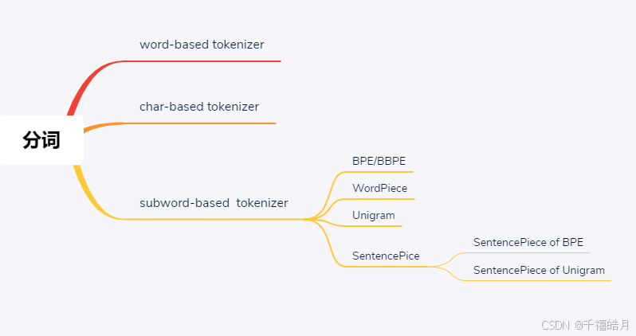
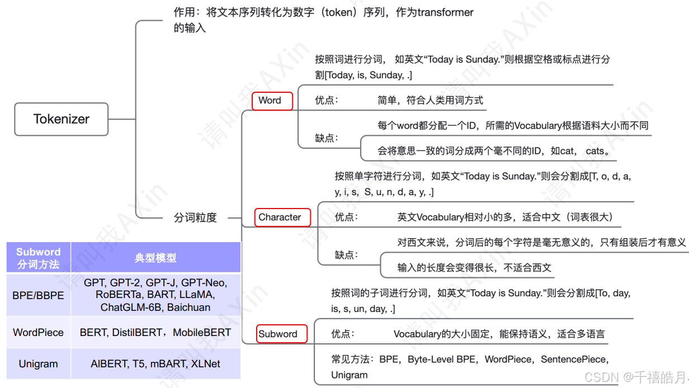
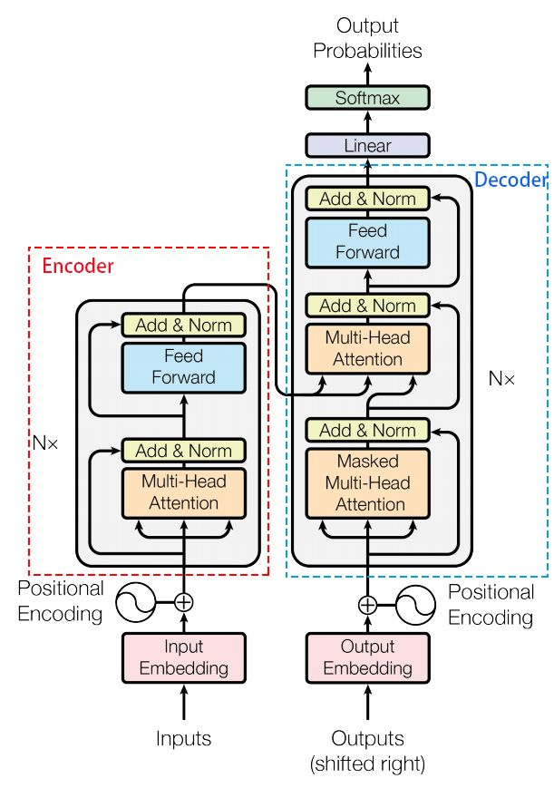

# NLP中的论文
## BERT原理
双层transorformer结构

CLS   与此词对应的最终隐藏状态被用作分类任务的序列聚合表示
SEP   用于分割

## bert微调
### 输入输出
输入序列，句子分段标记   ------ 任务目标

BERT4Rec: Sequential recommendation with bidirectional encoder representations from transformer

## 框架

uer-py 是由 DIIR 实验室开源的一个 Python 实现的预训练语言模型集合。它的核心特点是模块化设计，集成了多种预训练模型，如 BERT、RoBERTa、ALBERT 等，并提供统一的接口，方便使用者在不同模型之间切换。uer-py 还支持自定义模型架构和预训练任务，包含丰富的数据处理工具，可用于文本分类、命名实体识别、机器翻译、问答系统等多种自然语言处理任务。

[uer-py](https://github.com/dbiir/UER-py/)

TextBrewer  实现模型蒸馏的功能
[textBrewer](https://github.com/dbiir/UER-py#)

# NLP流水线
```
原始文本 → [SentencePiece 分词] → Token 序列 → [Embedding 层] → 向量序列 → [模型其他层（如注意力层）] → 最终输出（分类、翻译等）

```

# LLM中分词方法




参考文章：[LLM中分词方法](https://blog.csdn.net/qq_46018418/article/details/141647821)

# Tokenizer（分词器）

Tokenizer 是大模型中的**关键预处理组件**，负责将文本转换为模型可以处理的数字序列。它在自然语言处理中扮演着转换器、压缩器和标准化器的角色。

## 1.1 Tokenizer 的核心作用

### 1.1.1 文本预处理

将原始文本（字符串）转换为模型可理解的数字表示（token IDs）

```
原始文本: "Hello, world!"
分词后: [101, 102, 103]  # 每个 token 对应一个数字 ID
```

### 1.1.2 词汇管理

- 建立词汇表（vocabulary）：包含所有可能的 token
- 将常见的字符、单词、子词映射为 token

### 1.1.3 压缩和效率

- 将长文本压缩为更短的 token 序列
- 减少模型输入维度，提高计算效率

### 1.1.4 标准化处理

- 统一不同格式的文本（大小写、标点等）
- 处理多语言文本
- 处理特殊符号和专业术语

## 1.2 Tokenizer 的工作原理

### 1.2.1 基础用法

```python
# 编码：文字转数字
input_ids = tokenizer.encode('Hello World!', return_tensors='pt')

# 生成任务
output = model.generate(input_ids, max_length=50)  # output 是数字序列

# 解码：数字转文字
decoded_text = tokenizer.decode(output[0])
```

### 1.2.2 与 Embedding 的关系

Tokenzier 将 token 序列编码成整数序列后，不需要再变成 one-hot 向量，而是直接通过 `nn.Embedding` 映射为稠密向量。`nn.Embedding` 是直接根据索引查表，不需要做矩阵乘法。

### 1.2.3 常见分词策略

**1. Word-based Tokenizer（基于单词）**

- **工作原理**：按空格分词
- **示例**：`"Hello world"` -> `["Hello", "world"]`
- **优点**：简单直观
- **缺点**：词汇表可能很大，难以处理新词

**2. Character-based Tokenizer（基于字符）**

- **工作原理**：按字符分词
- **示例**：`"Hello"` -> `["H", "e", "l", "l", "o"]`
- **优点**：词汇表很小（通常 <256），能处理任何文本
- **缺点**：序列长度很长，语义信息少，计算成本高

**3. Subword Tokenizer（子词分词器）- 最常用**

**a. Byte Pair Encoding (BPE)**

- **使用模型**：GPT、RoBERTa
- **原理**：从字符开始，逐步合并最常见的连续字符序列
- **示例**：`"un" + "known"` -> `"unknown"`

**b. WordPiece**

- **使用模型**：BERT
- **原理**：类似 BPE，但基于概率选择合并
- **特点**：更注重语言统计特性

**c. Unigram**

- **使用模型**：XLNet、ALBERT
- **原理**：基于概率的子词选择
- **特点**：更灵活的分词策略

## 1.3 Tokenizer 的关键功能

### 1.3.1 编码（Encoding）

将文本转换为 token IDs 序列

```python
# 示例：BERT Tokenizer
text = "自然语言处理"
token_ids = tokenizer.encode(text)  # [101, 102, 103, 104]
```

### 1.3.2 解码（Decoding）

将 token IDs 序列转换回文本

```python
token_ids = [101, 102, 103, 104]
text = tokenizer.decode(token_ids)  # "自然语言处理"
```

### 1.3.3 特殊 token 处理

- **Padding token**：填充序列以达到统一长度
- **Mask token**：用于掩码语言建模（BERT）
- **Separator token**：分隔句子或段落
- **Start/End token**：标记序列的开始和结束
- **Unknown token**：处理不在词汇表中的词

### 1.3.4 长度控制

- **Max length**：限制输入序列的最大长度
- **Truncation**：截断过长的文本
- **Padding**：填充过短的文本
- **Stride**：处理超长文本的分段策略

## 1.4 Tokenizer 的重要性

### 1.4.1 影响模型性能

- 分词质量直接影响模型的理解能力
- 不当的分词可能导致语义丢失或误解
- 好的 Tokenizer 能更好地捕捉语言结构

### 1.4.2 决定序列长度

- Token 数量决定了模型的输入维度
- 影响内存消耗和计算时间
- 影响模型的上下文窗口大小

### 1.4.3 多语言支持

- 需要处理不同语言的字符集
- 中文需要特殊处理（汉字 vs 子词）
- 混合语言文本的处理策略

### 1.4.4 特殊符号处理

- 标点符号、数字、URL、邮箱等
- 表情符号、特殊字符
- 技术术语、科学名词

## 1.5 主流模型的 Tokenizer

### 1.5.1 BERT Tokenizer

- **算法**：WordPiece
- **词汇表大小**：约 30,000
- **特点**：包含中文、英文等多语言支持
- **特殊 token**：`[CLS]`、`[SEP]`、`、`[PAD]`

### 1.5.2 GPT Tokenizer

- **算法**：Byte Pair Encoding (BPE)
- **词汇表大小**：约 50,000
- **特点**：擅长处理英文文本
- **特殊 token**：` 等

### 1.5.3 T5 Tokenizer

- **算法**：基于 SentencePiece
- **词汇表大小**：约 32,000
- **特点**：支持多语言，统一编码格式
- **特殊 token**：任务特定的前缀 token

### 1.5.4 中文专用 Tokenizer

- **BERT-Chinese**：基于汉字的分词
- **GPT-3中文**：结合子词和汉字的分词策略
- **ERNIE**：百度开发的专用中文 Tokenizer

## 1.6 Tokenizer 的挑战

### 1.6.1 词汇表爆炸

- 新词不断出现（技术术语、网络用语等）
- 需要定期更新词汇表
- 平衡通用性和专业性

### 1.6.2 多语言平衡

- 不同语言在词汇表中的权重分配
- 避免偏向特定语言（如英文占主导）
- 处理混合语言文本

### 1.6.3 专业术语处理

- 技术术语、科学名词的准确分词
- 领域特定词汇的识别
- 缩写和简写的处理

### 1.6.4 效率与质量权衡

- 更小的词汇表 -> 更快的处理速度
- 更大的词汇表 -> 更好的分词质量
- 需要在速度和准确性之间平衡

### 1.6.5 上下文依赖

- 同一个词在不同上下文中的含义不同
- Tokenizer 通常是上下文无关的
- 需要后续的模型层来处理上下文

## 1.7 Tokenizer 的未来发展

### 1.7.1 动态词汇表

- 根据使用场景动态调整词汇表
- 自适应学习新词汇
- 个性化分词策略

### 1.7.2 上下文感知分词

- 考虑上下文信息进行分词
- 减少歧义和不准确分词
- 结合语义信息的分词策略

### 1.7.3 多模态分词

- 文本与图像、音频的联合分词
- 跨模态的统一表示
- 多模态大模型的预处理

### 1.7.4 高效压缩算法

- 更高效的文本压缩策略
- 减少 token 数量的同时保持语义
- 适应更大规模的模型

## 1.8 总结

Tokenizer 是**大模型的前门**，没有合适的 Tokenizer，大模型就无法有效地理解和处理人类语言。它的主要角色包括：

1. **转换器**：将人类语言的文本转换为机器可理解的数字序列
2. **压缩器**：减少输入维度，提高计算效率
3. **标准化器**：统一不同格式和语言的文本
4. **语言适配器**：处理多语言和特殊符号

选择和使用合适的 Tokenizer 对于大模型的性能至关重要。

## 1.9 学习资源

- [从词到数：Tokenizer与Embedding串讲 - Hao Bai的文章](https://zhuanlan.zhihu.com/p/631463712)
- [HuggingFace Transformers Tokenizer 文档](https://huggingface.co/docs/transformers/tokenizer_summary)

## 1.10 tokenizer实践

```
 logit_bias: Optional[Dict[str, int]] | Omit = omit,   可以用这个参数控制--给某些词的分数手动加减分

```

### 参考文献

1. Devlin, J., et al. (2019). BERT: Pre-training of Deep Bidirectional Transformers for Language Understanding.
2. Radford, A., et al. (2019). Language Models are Unsupervised Multitask Learners.
3. Raffel, C., et al. (2020). Exploring the Limits of Transfer Learning with a Unified Text-to-Text Transformer.
4. Kudo, T., & Richardson, J. (2018). SentencePiece: A simple and language independent subword tokenizer and detokenizer for Neural Text Processing.

# Transformer Block 结构

Transformer 中的一个基本 block 结构公式：

```
Output = LayerNorm(Input + FFN(Input))
```

其中：

- **LayerNorm**：层归一化
- **FFN**：前馈神经网络
- **+**：残差连接

## transformer 示意图



### 学习资源

[Transformer模型详解（图解最完整版）](https://zhuanlan.zhihu.com/p/338817680)

# embedding选择
word
pos
seg
sinusoidalpos
dual

# 模型的评估与选择
好的，我们来详细、清晰地解释一下准确率（Precision）和召回率（Recall）这两个在机器学习和数据挖掘中至关重要的评估指标。

核心思想：不同的关注点
想象一个捕鱼的情景：

准确率关心的是： 你捞上来的鱼里，有多少是真正的目标鱼（比如金枪鱼）？它追求的是“宁缺毋滥”。
召回率关心的是： 整个池塘里所有的目标鱼（金枪鱼），你捞上来了多少？它追求的是“宁可错杀，不可放过”。
这两个指标通常是一对矛盾体。提高准确率可能会降低召回率（更挑剔，捞得更少），提高召回率可能会降低准确率（撒大网，捞上很多杂鱼）。

极端情况考虑：、
- 我把鱼全部捕获出来，那么召回就是100%，但是准确率会不高；
- 假设我只捞取一条金枪鱼，那么准确率是100%，召回不足（因为鱼塘还有很多其他的鱼）

| 指标 | 公式 | 关注点 | 通俗解释 | 应用场景 |
|:---|:---|:---|:---|:---|
| **准确率 (Precision)** | $\frac{TP}{TP + FP}$ | **预测为正的样本**中有多少是**真的正样本** | 你**捞上来的鱼**里，有多少是**你想要的目标鱼** | 垃圾邮件识别、推荐系统 防止错报 \n  准确率非常高（推荐的内容用户基本都喜欢），但召回率会较低（很多用户可能也喜欢的内容没有被推荐出来，即FN漏报很多） |
| **召回率 (Recall)** | $\frac{TP}{TP + FN}$ | **所有真正的正样本**中，有多少**被预测出来了** | **整个池塘里**所有的目标鱼，你**捞上来了多少** | 疾病筛查、安全隐患检测  防止漏报 召回率非常高（几乎所有的病人都被找出来了），但准确率会很低（很多健康人被误诊为癌症，即FP误报很多）|
| **F1分数 (F1-Score)** | $2 \times \frac{Precision \times Recall}{Precision + Recall}$ | **准确率**和**召回率**的**调和平均数**、**综合性能** | **既不放过太多鱼，也不捞太多垃圾**的**平衡点** | 需要综合评估模型性能的场景 |

# 中文常见分词工具

| 特性               | Jieba                          | HanLP                          |
|--------------------|-------------------------------|--------------------------------|
| **分词算法**       | 基于词典匹配（Trie树）         | 混合模型（词典+深度学习）       |
| **功能范围**       | 基础分词、关键词提取、词性标注 | 分词、NER、句法分析、语义分析等 |
| **未登录词处理**   | 较弱                           | 较强（依赖深度学习模型）        |
| **性能**           | 轻量级，适合小规模数据         | 适合大规模数据，但资源消耗高    |
| **语言支持**       | 中文                           | 多语言（中、英、日等）          |
| **使用难度**       | 简单                           | 中等（需配置模型和依赖）        |
| **典型应用场景**   | 快速分词、小型项目             | 工业级 NLP 任务、复杂文本分析   |

## jieba

## HanLP

# 评估
CLUE
