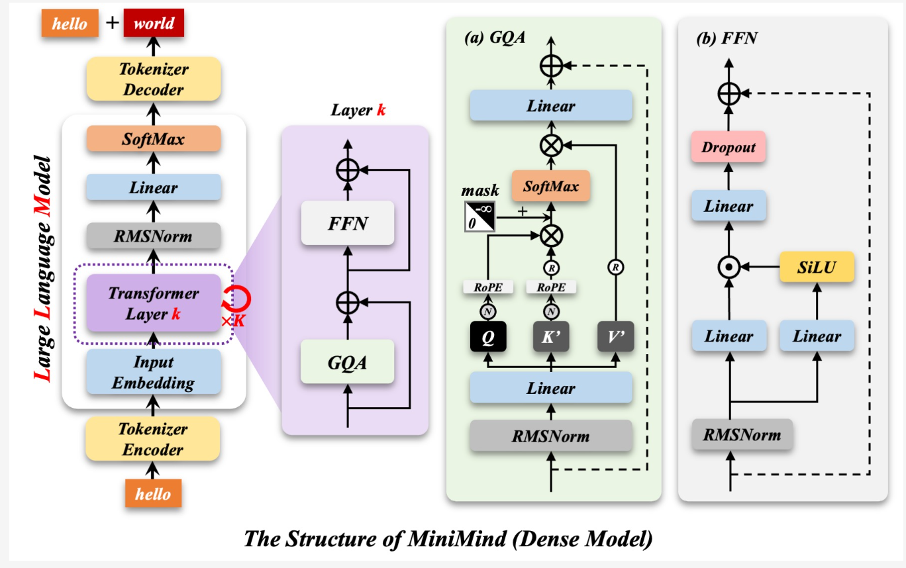
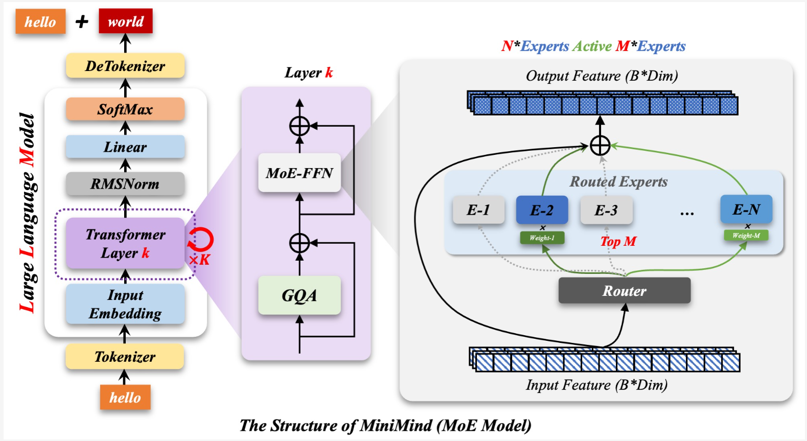
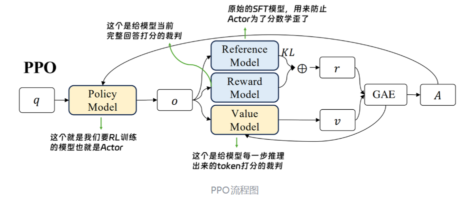
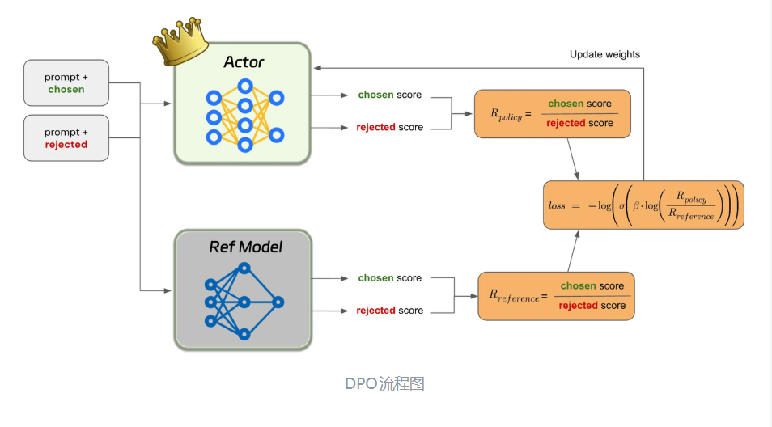
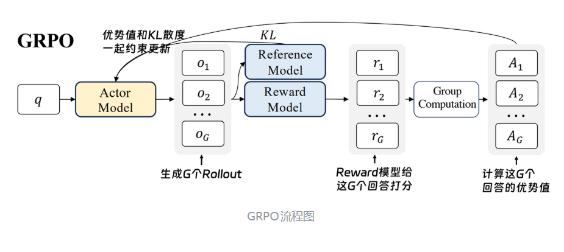

# MiniMind 模型架构与预训练技术解读

## 1. MiniMind 模型架构

### 1.1 MiniBlock 结构

MiniMind 模型的核心组件是 MiniBlock，其结构如下图所示：





### 1.2 MiniBlock 代码实现

```python
class MiniMindBlock(nn.Module):
    """MiniMind 模型的核心块结构"""

    def __init__(self, layer_id: int, config: MiniMindConfig):
        super().__init__()

        # 自注意力机制
        self.self_attn = Attention(config)

        # 层归一化
        self.input_layernorm = RMSNorm(config.hidden_size, eps=config.rms_norm_eps)
        self.post_attention_layernorm = RMSNorm(config.hidden_size, eps=config.rms_norm_eps)

        # MLP 或 MoE 前馈网络
        if not config.use_moe:
            self.mlp = FeedForward(config)
        else:
            self.mlp = MOEFeedForward(config)

    def forward(self, hidden_states, attention_mask=None):
        # 前向传播逻辑
        # 1. 输入层归一化
        # 2. 自注意力计算
        # 3. 残差连接
        # 4. 后注意力层归一化
        # 5. MLP/MoE 前馈网络
        # 6. 最终残差连接
        pass
```

### 1.3 架构特点

1. **RMSNorm**：使用 RMSNorm 替代传统的 LayerNorm
2. **注意力机制**：支持多种注意力优化
3. **MoE 支持**：可选的混合专家前馈网络
4. **残差连接**：每个子层后都有残差连接

## 2. 预训练关键技术

预训练是标准的自回归的训练,**用前面的 token 预测下一个 token**

```
            res = model(input_ids, labels=labels)    # input
```

### 2.1 数据预处理

- Tokenizer 配置与优化
- 数据集清洗与过滤
- 序列长度处理

### 2.2 训练策略

- 学习率调度
- 优化器选择（AdamW 等）
- 梯度累积与 clipping
- 混合精度训练 ---(TODO)

### 2.3 评估指标

- Perplexity（困惑度）
- 下游任务 zero-shot 性能
- 推理效率（token/s）

---

### 预训练实践

#### 读懂日志表达

```

Model Params: 63.91M
Trainable Params: 63.912M
Generating train split: 1270238 examples [00:07, 176772.60 examples/s] --此处卡住之后，会耗时，因为正在切分token
```

#### 验证CUDA是否可用

如果明明有GPU但是运行时候不显示GPU,可以检查torch的版本号

```
python -c "import torch; print('GPU可用:', torch.cuda.is_available()); print('GPU数量:', torch.cuda.device_count())"

GPU可用: True
GPU数量: 1
```

## 3. SFT技术

全参数微调

## 4. 强化学习

https://www.zhihu.com/search?type=content&q=PPO

人人都能看懂的RL-PPO理论知识 - 猛猿的文章 - 知乎
https://zhuanlan.zhihu.com/p/7461863937

https://www.zhihu.com/search?type=content&q=PPO%E8%AE%AD%E7%BB%83%E5%AE%9E%E8%B7%B5

PPO的四个模型：


Actor模型(Policy Model)：待训练模型，

Critic Model(Value Model）： 预估总收益（即时+未来；**也就是在t** **时刻，我们给不出客观存在的总收益** Vt **，我们只能训练一个模型去预测它。**

Reward Model: 奖励模型，参数冻结

Reference Model：参考模型，参数冻结

PPO的数据集

dpo



GRPO：

GRPO的三个模型
Actor模型（Policy Model)
Reference Model
Reward Model

**本文持续更新中...**
