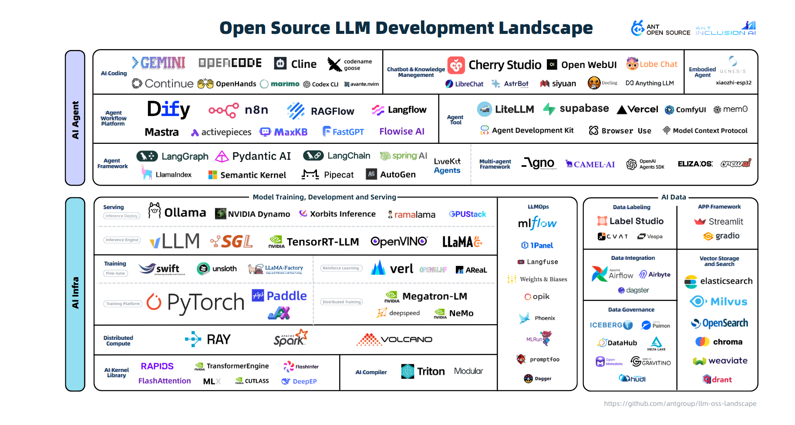
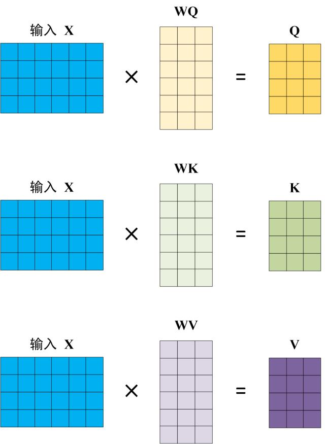
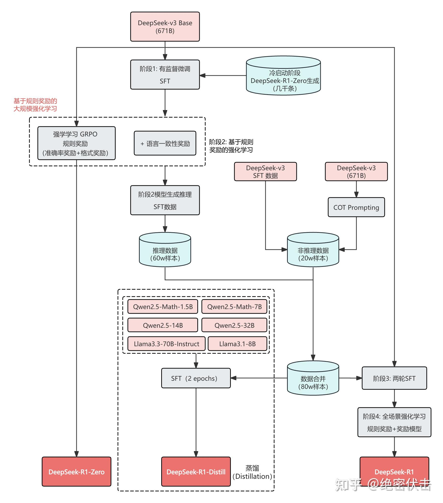

# 大模型技术报告

## 开源大模型生态概览



参考：[大模型进展 - antgroup/llm-oss-landscape](https://github.com/antgroup/llm-oss-landscape)

## 名词解释

- **下采样** —— 摘要
- **上采样** —— 扩写

**低秩分解** —— 是一种用于简化矩阵或张量结构的核心技术。它的核心思想是：发现大规模数据中隐藏的低维结构，将一个高秩的矩阵或张量近似表示为多个低秩矩阵或张量的组合。

**矩阵的秩** —— 秩是描述矩阵“本质特征”和“包含有效信息量”的最核心概念之一。简单来说，它衡量了矩阵中有多少行（或列）是真正独立、不重复的。

## Transformer

参考：[Transformer 详解 - 知乎](https://zhuanlan.zhihu.com/p/338817680)

## 注意力机制



1. **概念来源：信息检索系统的“解耦”**。这个设计灵感来源于数据库或信息检索系统（比如你在搜索引擎里搜视频）：
   - **Query ($Q$)**：你想找什么（比如输入搜索框的关键词：“猫咪 搞笑”）
   - **Key ($K$)**：视频的标签/索引（比如平台视频的标签：“宠物”、“搞笑”、“日常”）
   - **Value ($V$)**：视频的实际内容（点击进去看到的视频画面）

   如果不用三个向量，而是直接拿输入向量 $X$ 自己跟自己算相似度，这意味着：一个词“希望别人怎么看待它”（作为被查询者）和“它想去寻找什么”（作为查询者），在数学上被完全绑定了。

   通过引入 $Q$ 和 $K$，我们将“主动寻找”和“被动匹配”两个角色分离开来。同一个词，在扮演 $Q$ 时可以去寻找动词，在扮演 $K$ 时可以被形容词修饰。通过引入 $V$，我们将“计算关联度的权重”与“实际传递的信息”分离开来。

参考：[超细图解 MLA 计算流 & 吸收矩阵对比分析 - kaiyuan - 知乎](https://zhuanlan.zhihu.com/p/1948769945132470860)

## KV Cache 等

参考：[从零实现一个玩具版 LLM 推理引擎（一）：用最简单代码彻底搞懂 Pre-fill、Decode 和 KV Cache - superjet - 知乎](https://zhuanlan.zhihu.com/p/2018242525970835129)

## DeepSeek 系列

| 技术创新                                                                                          | 模型版本               | 发布时间   |
| :------------------------------------------------------------------------------------------------ | :--------------------- | :--------- |
| DeepSeek MoE 架构                                                                                 | DeepSeek-MOE[1]        | 2024年1月  |
| Group Relative Policy Optimization (GRPO，群体相对策略优化)                                       | DeepSeek-Math[2]       | 2024年4月  |
| Multi-Head Latent Attention (MLA，多头隐式注意力)                                                 | DeepSeek-V2[3]         | 2024年6月  |
| Multi-Token Prediction (MTP，多令牌预测)                                                          | DeepSeek-V3[4]         | 2024年12月 |
| AI Infra 相关（以训练加速为主，如 FP8 混合精度训练、DualPipe+ 等）                                | DeepSeek-V3[4]         | 2024年12月 |
| 通过强化学习显著提升模型推理能力，R1-Zero 在 AIME 2024 等推理基准测试中达到 OpenAI-o1-0912 的水平  | DeepSeek-R1-Zero[5]    | 2025年1月  |
| 使用冷启动-强化学习（推理场景）-SFT-强化学习（全场景）四阶段训练，R1 模型达到 OpenAI-o1-1217 的水平 | DeepSeek-R1[5]         | 2025年1月  |
| 将 R1 推理能力蒸馏到小的稠密模型                                                                  | DeepSeek-R1-Distill[5] | 2025年1月  |

### DeepSeek-V3

参考：[超细图解 MLA 计算流 & 吸收矩阵对比分析 - kaiyuan - 知乎](https://zhuanlan.zhihu.com/p/1948769945132470860)

### DeepSeek-R1



- **冷启动**
- **消融实验** —— 控制变量
- **拒绝采样** —— “大批量试镜 ➡️ 严格打分 ➡️ 留下优秀的，拒绝差的”的过程，就是**拒绝采样**。

参考：

- [DeepSeek 关键技术详解 - 腾讯技术工程 - 知乎](https://zhuanlan.zhihu.com/p/23048347789)
- [DeepSeek-R1 技术报告解读 - 绝密伏击 - 知乎](https://zhuanlan.zhihu.com/p/19868935152)
- 论文：[DeepSeek-R1 (arXiv:2501.12948)](https://arxiv.org/abs/2501.12948)

### DeepSeek-V4

- [DeepSeek-V4-Pro 技术报告 (HuggingFace)](https://huggingface.co/deepseek-ai/DeepSeek-V4-Pro/blob/main/DeepSeek_V4.pdf)
- [桔了个仔的回答 - 知乎](https://www.zhihu.com/question/2030963929510310856/answer/2030972531839124459)

## Qwen3.5

```text
(APIServer pid=63128) INFO 06-05 15:47:35 [loggers.py:271] Engine 000: Avg prompt throughput: 43.4 tokens/s, Avg generation throughput: 6.1 tokens/s, Running: 1 reqs, Waiting: 0 reqs, GPU KV cache usage: 1.6%, Prefix cache hit rate: 0.0%
```

prefix cache hit 是滑动窗口取的一段时间的均值。
