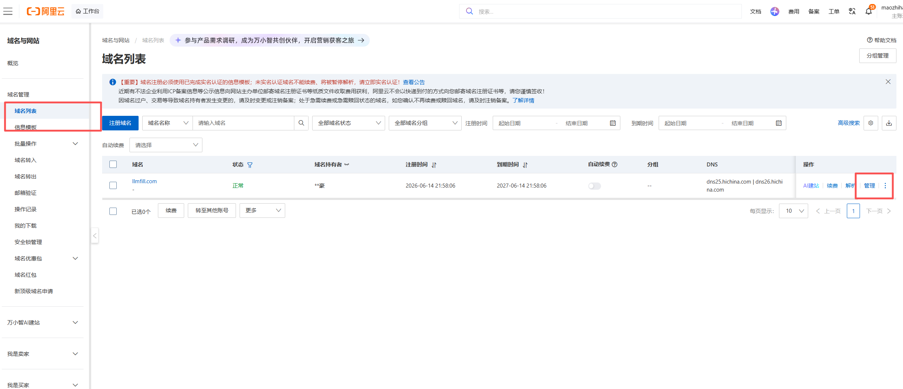
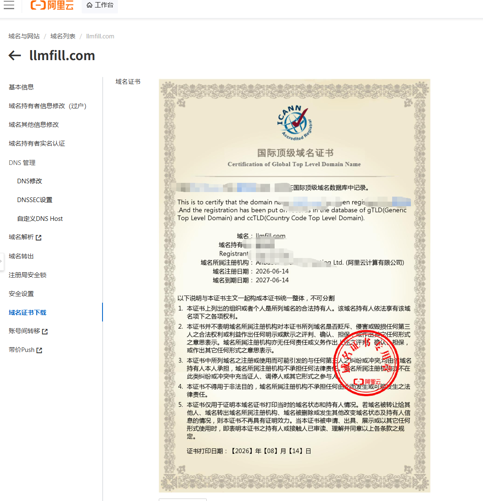
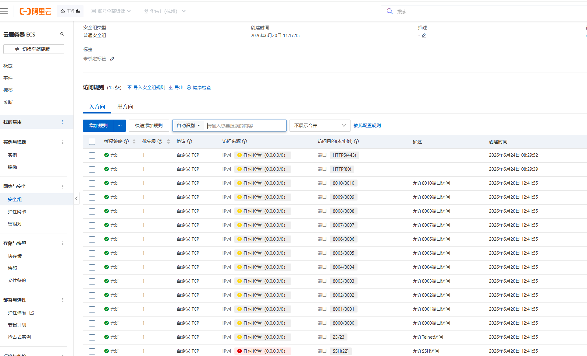
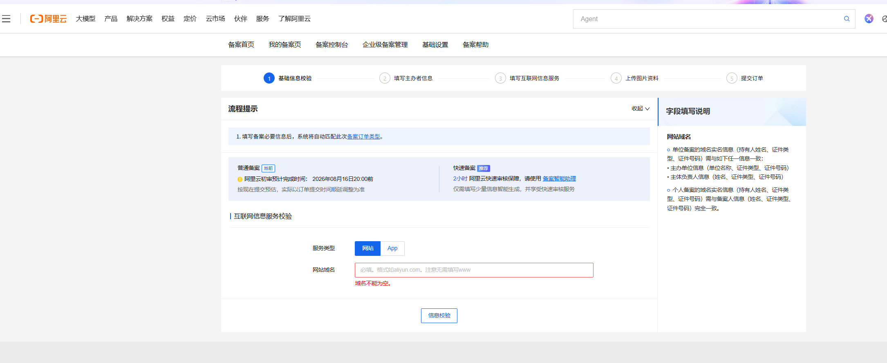
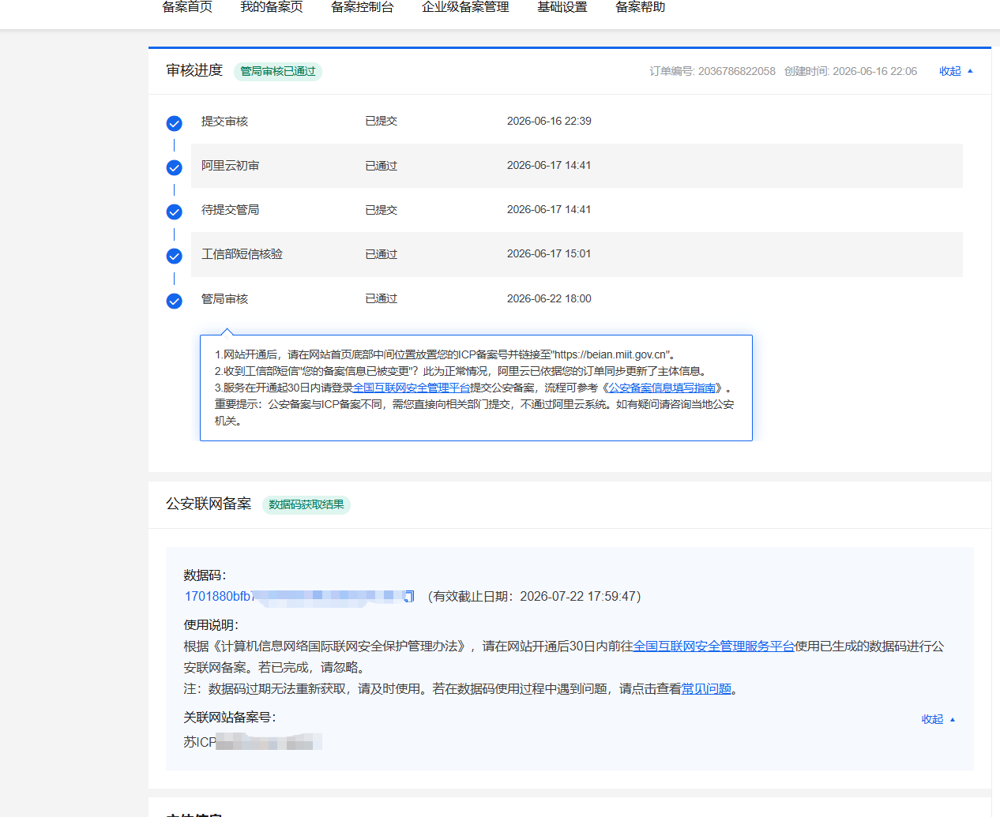
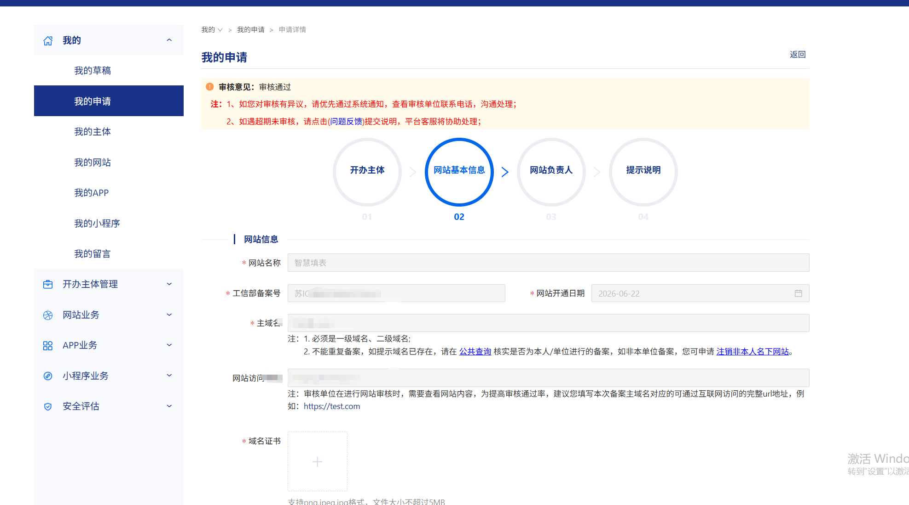
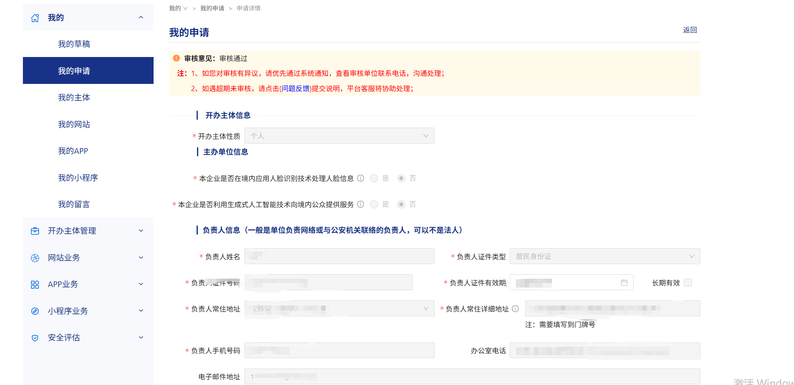
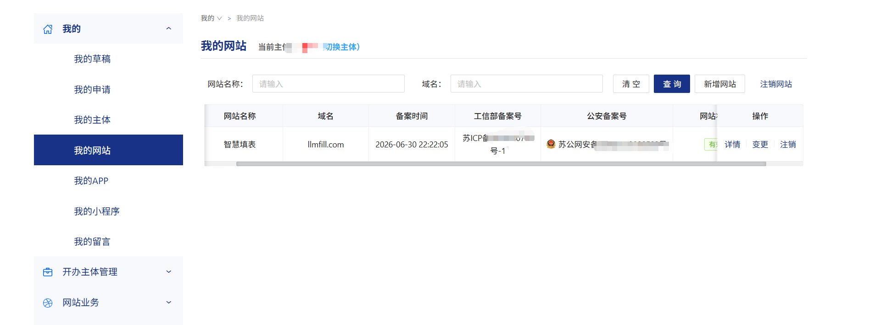
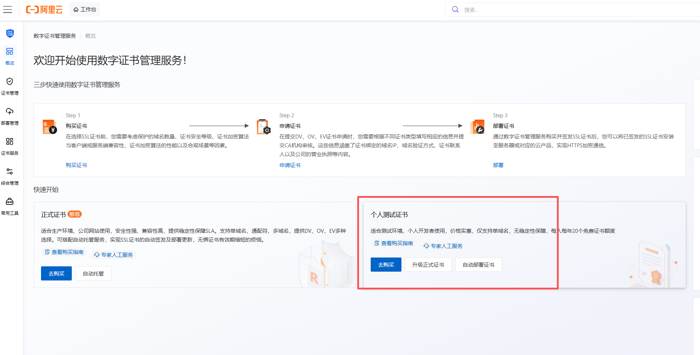

本篇梳理在阿里云上从 0 到 1 搭建并上线一个网站的整体流程，按时间顺序覆盖准备、选购、备案、部署、解析、优化、运维各个阶段。

## 流程总览

```
需求规划 -> 注册认证 -> 域名注册 -> 选购服务器 -> ICP 备案 -> 公安备案 -> 环境搭建 -> 网站部署 -> 域名解析 -> HTTPS 配置 -> 性能安全优化 -> 上线运维
```

## 前期准备

- 明确网站定位与类型（个人博客 / 企业官网 / 电商 / 应用）
- 梳理功能需求与目标用户
- 规划技术选型（静态站点 / CMS 建站 / 自研应用）
- 预估访问量，初步确定服务器规格与带宽
- 本文所有示例以阿里云为示例，如果对应地址点击失败，可以直接访问阿里云--在搜索去直接搜索关键词功能就可以了

## 一、注册账号与实名认证（本人采用阿里云服务器）

- 注册阿里云账号
- 完成个人 / 企业实名认证（购买大陆服务器的前置条件）
- 绑定支付方式，关注新用户折扣活动

### 服务器厂商对比

国内主流云厂商均可满足建站需求，这里对比阿里云、腾讯云、火山引擎三家：

| 厂商 | 市场定位 | 价格 | 产品生态 | 适合人群 |
|------|---------|------|---------|---------|
| **阿里云** ⭐（本文采用） | 国内份额第一，全行业通吃 | 新人 2-3 折力度大，续费价需关注 | 最全（ECS/OSS/CDN/RDS/SLB 等） | 个人 / 企业 / 全场景 |
| 腾讯云 | 国内第二，社交游戏见长 | 常打价格战，首年便宜 | 较全，社交 / 游戏生态强 | 中小企业、个人开发者 |
| 火山引擎 | 字节跳动旗下，新兴上升期 | 性价比高，新人折扣可观 | 视频云 / AI 大模型较强，基础计算够用 | 短视频 / 直播 / AI 业务、追求性价比 |

**几点说明：**

- **生态优先**：若后续要用 CDN、对象存储、数据库等配套服务，阿里云、腾讯云的一站式体验最好，账号互通、控制台统一；火山引擎在音视频 / AI 方向更专。
- **新人价 vs 续费价**：各厂商首年价格都很低，但要关注**续费 / 到期价**，建议一次买多年锁定折扣。
- **备案前提**：只要服务器在**中国大陆**，任何厂商都必须 ICP 备案；想免备案只能选香港 / 海外节点，但访问速度和稳定性会打折。
- **本文选择阿里云**的原因：市场份额最大、产品线最全、备案流程最成熟、文档与社区资源最丰富，遇到问题最容易搜到解决方案，适合新手。

## 二、域名注册

- 查询并购买域名（.com / .cn / .top 等），个人建站通常优先选 .com 等国际域名，具体按业务类型决定
- 完成域名实名认证（必须通过才能解析、备案）
- 保存域名证书，备案时需要

> 域名管理地址：[https://dc.console.aliyun.com/next/index#/domain-list/all](https://dc.console.aliyun.com/next/index#/domain-list/all)





## 三、选购云服务器

ICP 备案的接入信息需要填写服务器公网 IP，因此服务器要在备案之前买好。

- 选型对比：轻量应用服务器（新手友好） vs ECS（更灵活）
- 选择地域（靠近目标用户；大陆节点需备案）
- 选择镜像（操作系统 + 应用环境，如 Alibaba Cloud Linux / Ubuntu + Nginx）
- 配置带宽计费方式与安全组
- 规划购买时长与续费策略

安全组配置，开放必要端口（HTTP 80、HTTPS 443、SSH 22 等）：



## 四、ICP 备案

> 阿里云个人备案参考：[官方文档](https://help.aliyun.com/zh/icp-filing/basic-icp-service/getting-started/quick-start-for-icp-filing-for-personal-websites?spm=a2c4g.11186623.0.0.35574e52YV5Vdb)

- 备案三要素：域名 + 大陆服务器 + 实名认证
- 通过阿里云备案系统提交申请（[备案入口](https://beian.aliyun.com/pcContainer/selfEntity?entityId=11242866)）
- 准备材料：身份证、网站负责人信息、网站地址等
- 等待管局审核（一般 7-20 个工作日）
- 通过后按需完成公安备案




## 五、公安备案

ICP 备案通过后，需在 30 日内到公安机关办理网站备案。

> 公安备案地址：[https://beian.mps.gov.cn/#/](https://beian.mps.gov.cn/#/)
> 申请文档参考：[阿里云公安备案指南](https://help.aliyun.com/zh/icp-filing/basic-icp-service/quick-start-for-public-security-network-filing-for-personal-websites?spm=a2c4g.11186623.0.0.3c4c7cafAUm3yb#db8fd938728bu)

主要步骤：新增主体 → 新增网站 → 等待审核。





## 六、服务器环境搭建

> 本节按自己项目自行安装搭建即可，下文「网站部署」以常见的 Nginx + 静态站点 / 反向代理方案为例。

- 远程连接（Workbench / SSH / 远程桌面）
- 安装 Web 运行环境（宝塔面板 / LNMP / Docker 等）
- 配置安全组与防火墙，开放必要端口
- 创建站点目录与数据库

## 七、网站部署

以 Nginx 部署一个网站为例，完整流程如下。

### 安装 Nginx

按服务器操作系统选择包管理器：

```bash
# Alibaba Cloud Linux / CentOS / RHEL
yum install -y nginx

# Ubuntu / Debian
apt update && apt install -y nginx

# 启动并设置开机自启
systemctl start nginx
systemctl enable nginx
```

安装完成后，浏览器访问服务器公网 IP，能看到 Nginx 默认欢迎页即表示安装成功。

### Nginx 目录结构

| 路径 | 说明 |
|------|------|
| `/etc/nginx/nginx.conf` | 主配置文件（全局设置） |
| `/etc/nginx/conf.d/*.conf` | 站点配置文件（每个站点一个，推荐） |
| `/usr/share/nginx/html/` | 默认网站根目录 |
| `/var/log/nginx/` | 日志目录（access.log / error.log） |

### 上传网站代码

将本地构建产物上传到服务器，例如放到 `/var/www/mysite`：

```bash
# 方式一：scp 直接上传
scp -r ./dist/* root@<服务器IP>:/var/www/mysite/

# 方式二：在服务器上建目录后用宝塔 / SFTP 上传
mkdir -p /var/www/mysite
```

设置目录权限，保证 Nginx 进程能读取：

```bash
chown -R nginx:nginx /var/www/mysite   # Ubuntu 用户改用 www-data:www-data
chmod -R 755 /var/www/mysite
```

### 配置站点（server 块）

新建站点配置 `/etc/nginx/conf.d/mysite.conf`：

```nginx
server {
    listen       80;                          # 监听端口，HTTP 用 80
    server_name  www.example.com;             # 绑定域名（域名解析生效后再填）
    root         /var/www/mysite;            # 网站根目录
    index        index.html index.htm;        # 默认首页

    # 上传体积限制（默认 1M，按需调大）
    client_max_body_size 20m;

    # gzip 压缩，减小传输体积
    gzip on;
    gzip_types text/plain application/javascript text/css application/json;

    location / {
        try_files $uri $uri/ /index.html;     # 单页应用（SPA）路由兜底
    }

    # 静态资源缓存
    location ~* \.(jpg|jpeg|png|gif|ico|css|js|woff2?)$ {
        expires 30d;
        add_header Cache-Control "public";
    }

    # 反向代理到后端服务（FastAPI / Node 等，按需开启，详见下文「反向代理与请求头透传」）
    # location /api/ {
    #     proxy_pass http://127.0.0.1:8000;
    #     include /etc/nginx/conf.d/proxy_common.conf;
    # }
}
```

### 测试与生效

```bash
nginx -t                  # 检查配置语法是否正确
nginx -s reload           # 平滑重载，不中断服务（也可用 systemctl reload nginx）
```

### 常用运维命令

| 操作 | 命令 |
|------|------|
| 启动 | `systemctl start nginx` |
| 停止 | `systemctl stop nginx` |
| 重启 | `systemctl restart nginx` |
| 重载配置 | `nginx -s reload` |
| 检查配置 | `nginx -t` |
| 查看状态 | `systemctl status nginx` |

### 反向代理与请求头透传（进阶）

当 Nginx 把请求转发给后端（FastAPI / Node / Tomcat 等）时，默认只会让后端看到「Nginx 在内网调它」，后端拿不到用户的真实 IP、原始域名和协议。这会导致**日志失真、限流失效、回调链接生成错误**。解决方式是用 `proxy_set_header` 把原始请求信息透传给后端。

由于这些头每个反向代理 location 都要用，推荐抽成一个公共文件 `/etc/nginx/conf.d/proxy_common.conf`，各 location 用 `include` 复用：

```nginx
# /etc/nginx/conf.d/proxy_common.conf
# 公共反向代理头 -- 被各 location include 复用
# 把原始请求的来源信息（域名 / IP / 协议）透传给后端，
# 否则后端只能看到 Nginx 在内网调它，日志 / 限流 / 回调链接生成都会失真。

proxy_set_header Host               $host;                        # 原始域名
proxy_set_header X-Real-IP          $remote_addr;                 # 用户真实 IP
proxy_set_header X-Forwarded-For    $proxy_add_x_forwarded_for;   # 完整代理链
proxy_set_header X-Forwarded-Proto  $scheme;                       # http / https
proxy_set_header X-Forwarded-Host   $host;

# 超时
proxy_connect_timeout 30s;
proxy_send_timeout    60s;
proxy_read_timeout    60s;

# 缓冲
proxy_buffering         on;
proxy_buffer_size        8k;
proxy_buffers            8 16k;
proxy_busy_buffers_size 32k;
```

在 server 块的 location 里这样引用：

```nginx
location /api/ {
    proxy_pass http://127.0.0.1:8000;
    include /etc/nginx/conf.d/proxy_common.conf;
}
```

#### 场景说明

用户小明（IP `114.114.114.114`）用手机访问 `https://www.example.com`，Nginx（`192.168.1.100`）把请求转发给后端（`192.168.1.200`）。

**不配置这些头时**：后端收到的来源 IP 是 `192.168.1.100`（Nginx），域名可能是 `localhost` 或内网 IP，协议是 `http` -- 信息全乱。

**配置后逐行效果**：

| 配置行 | 含义 | 后端收到 | 为什么重要 |
|--------|------|---------|-----------|
| `Host $host` | 原始域名 | `Host: www.example.com` | 后端（如 Tomcat）按 Host 选虚拟主机，不传会回默认页或报错 |
| `X-Real-IP $remote_addr` | 用户真实 IP | `X-Real-IP: 114.114.114.114` | 后端日志 / 风控封禁要用，不传永远只看到 Nginx 内网 IP |
| `X-Forwarded-For $proxy_add_x_forwarded_for` | 完整代理链 | 无 CDN：`114.114.114.114`<br>经 CDN：`114.114.114.114, 55.55.55.55` | 通用标准，排查请求经过了哪些节点靠它 |
| `X-Forwarded-Proto $scheme` | 原始协议 | `X-Forwarded-Proto: https` | 防止后端「HTTP 跳 HTTPS」死循环；生成正确的 http/https 链接 |
| `X-Forwarded-Host $host` | 原始 Host | `X-Forwarded-Host: www.example.com` | 与 `Host` 类似，部分后端框架读这个头 |

#### 真实 IP 的用途（`X-Real-IP`）

后端拿到用户真实 IP（`X-Real-IP` 或 `X-Forwarded-For` 首段），服务于一切「识别来源 / 身份」相关的功能：

- **日志与审计**：访问日志记录「谁在几点访问了什么」，而不是清一色的 Nginx 内网 IP；出问题排查、合规审计都靠它。
- **风控 / 安全**：同一 IP 高频登录失败（撞库 / 爆破）自动封禁或触发验证码；识别 CC 攻击、刷接口；异地登录风险提示。
- **限流 / 防刷**：按真实 IP 做速率限制（如「每 IP 每分钟 10 次调用」）。
- **地域相关功能**：IP 反查地理位置，做属地内容、汇率 / 语言切换、就近门店、天气、灰度按地区放量。
- **统计分析**：UV、地域分布、来源热点分析。
- **反爬 / 反作弊**：识别同一 IP 高频抓取、刷量、薅羊毛。

**不传 `X-Real-IP` 时的失效场景**：后端 `request.getRemoteAddr()` 拿到的是 Nginx 内网地址（如 `192.168.1.100`），于是在后端眼里**全站所有用户都是同一个 IP**：

- 日志全是 `192.168.1.100`，分不清谁是谁；
- 限流阈值要么把正常用户一起误杀，要么对攻击者形同虚设；
- 想封禁恶意用户也无从下手，因为根本看不到真实来源。

#### 重点：`X-Forwarded-Proto` 防止重定向死循环

Nginx 做 SSL 卸载（解密 HTTPS）后，转给后端的是 HTTP。如果后端有「HTTP 强制跳 HTTPS」逻辑，不传这个头就会死循环：

```
浏览器请求 https  -> Nginx 解密 -> 转发 HTTP 给后端
后端一看是 HTTP   -> 302 跳转到 HTTPS
浏览器再请求 https -> Nginx 解密 -> 又转发 HTTP -> 后端又跳转 ...（死循环）
```

传了 `X-Forwarded-Proto: https`，后端就知道「用户那边其实是 HTTPS」，不再跳转；生成「找回密码」等链接时也会正确用 `https://`。

#### 设置 vs 不设置的对比

| 维度 | 设置 `proxy_common.conf` | 不设置（Nginx 默认） |
|------|-------------------------|---------------------|
| 用户真实 IP | ✅ 后端拿到 `X-Real-IP` | ❌ 后端只看到 Nginx 内网 IP |
| 原始域名 | ✅ `Host` 正确 | ❌ 可能是 `localhost` / 内网 IP，后端虚拟主机选错 |
| 原始协议 | ✅ `X-Forwarded-Proto` | ❌ 协议丢失，HTTPS 卸载后易触发重定向死循环 |
| 代理链追溯 | ✅ `X-Forwarded-For` | ❌ 多级代理链丢失，排查困难 |
| 多 location 维护 | ✅ `include` 复用，改一处全局生效 | ⚠️ 每个 location 重复写，易遗漏 / 不一致 |
| 配置复杂度 | ⚠️ 多一个公共文件 | ✅ location 里只写 `proxy_pass` |
| 适用场景 | 动态后端、有日志 / 风控需求 | 纯静态资源、或后端不在乎来源信息 |

一句话总结：**只要 Nginx 后面接的是动态应用（有日志、限流、回调链接、HTTPS 跳转判断），就该设置；纯静态资源直出、或后端完全不读来源信息时，不设置也无妨。**

## 八、域名解析与绑定

- 在域名控制台添加解析记录（A 记录指向服务器公网 IP）
- 在服务器端绑定域名（即上一步 Nginx 配置里的 `server_name`）
- 等待解析生效（受 TTL 影响，通常几分钟）

## 九、配置 HTTPS（SSL 证书）

HTTPS 能加密传输、提升信任度和 SEO 排名，备案通过后建议尽快上。阿里云提供免费 DV 证书，有效期 3 个月（90 天），到期前重新申请即可，无需付费。

> SSL 证书申请入口：阿里云控制台搜索「SSL 证书」，进入数字证书管理服务（[https://yundun.console.aliyun.com/?p=cas](https://yundun.console.aliyun.com/?p=cas)）。



### 申请免费证书

1. 进入 SSL 证书控制台 -> 免费证书 -> 立即购买（0 元）
2. 创建证书：填写绑定域名（如 `www.example.com`），验证方式选 DNS
3. 按提示到域名解析控制台添加一条 TXT 记录完成验证（域名也在阿里云时可自动添加）
4. 签发后下载证书，服务器类型选 **Nginx**，得到压缩包

### 上传证书到服务器

解压后包含两个文件（文件名以实际域名为准）：

| 文件 | 说明 |
|------|------|
| `www.example.com.pem` | 证书文件（含公钥 + 中间证书） |
| `www.example.com.key` | 私钥文件（务必保密） |

上传到服务器并设置权限：

```bash
mkdir -p /etc/nginx/cert
scp ./www.example.com.pem ./www.example.com.key root@<服务器IP>:/etc/nginx/cert/
chmod 644 /etc/nginx/cert/*.pem
chmod 600 /etc/nginx/cert/*.key
```

### 配置 Nginx（443 + 80 跳转）

修改 `/etc/nginx/conf.d/mysite.conf`，把原来单一的 80 端口块替换为「80 跳转 + 443 主站点」两段：

```nginx
# HTTP -> HTTPS 强制跳转
server {
    listen      80;
    server_name www.example.com;
    return 301 https://$host$request_uri;
}

# HTTPS 主站点
server {
    listen      443 ssl;
    server_name www.example.com;

    ssl_certificate     /etc/nginx/cert/www.example.com.pem;
    ssl_certificate_key /etc/nginx/cert/www.example.com.key;

    # 推荐的安全协议与加密套件
    ssl_protocols TLSv1.2 TLSv1.3;
    ssl_ciphers ECDHE-RSA-AES128-GCM-SHA256:HIGH:!aNULL:!MD5;
    ssl_prefer_server_ciphers on;

    # 会话缓存，减少握手开销
    ssl_session_cache shared:SSL:10m;
    ssl_session_timeout 10m;

    root  /var/www/mysite;
    index index.html index.htm;

    client_max_body_size 20m;

    location / {
        try_files $uri $uri/ /index.html;
    }
}
```

### 测试与生效

```bash
nginx -t                 # 检查配置
nginx -s reload          # 重载
```

浏览器访问 `https://www.example.com`，地址栏出现锁图标即成功；访问 `http://www.example.com` 会自动 301 跳转到 HTTPS。

### 续期提醒

- 免费证书有效期 3 个月，阿里云会在到期前提示，**务必及时重新申请并替换证书文件**（`.pem` / `.key` 覆盖后 `nginx -s reload`），否则浏览器会提示「不安全」。
- 建议在云监控设置证书到期告警，避免遗漏。

## 十、性能与安全优化

- 接入 CDN 加速静态资源
- 使用 OSS 对象存储图片 / 大文件
- 开启 WAF / DDoS 基础防护
- 定期更新系统与组件补丁

## 十一、上线与日常运维

- 配置云监控与告警规则
- 设置自动快照与数据备份
- 域名与服务器续费提醒，避免过期
- 日志查看与常见故障排查
